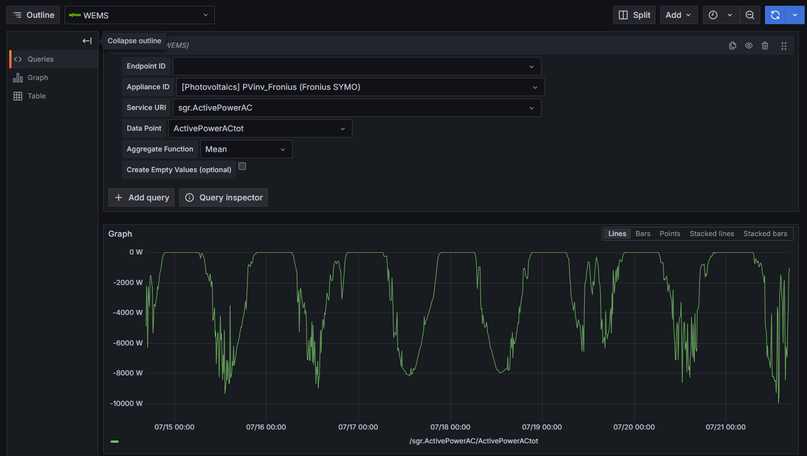

# WEMS Grafana Datasource Plugin

A Grafana datasource plugin for integrating and visualizing data from the **WAGO Energy Management System (WEMS)**. This plugin enables users to query, monitor, and analyze energy data directly within Grafana dashboards with a user-friendly interface.



## Features

- **Hierarchical Data Structure**: Navigate through Endpoints → Appliances → Services → Data Points
- **Multiple Aggregation Functions**: Mean, median, min, max, sum, count, first, last, derivative
- **Unit Mapping**: Automatic conversion of WEMS units to Grafana-friendly formats

## Requirements

| Component | Requirement |
|---|---|
| **Grafana** | Version 13.2.0 or higher |
| **Access** | Administrative access to the Grafana server and its configuration file |
| **WEMS API** | Client ID and Client Secret for authentication |
| **Network** | Outbound HTTPS (port 443) to the WEMS API (default: `https://c1.api.wago.com/wems`) |

---

# Installation

This plugin is **not signed by Grafana**, so Grafana has to be told explicitly that it is allowed to load it.

The steps below cover an installation via Docker.

## Step 1: Allow the unsigned plugin

### Option A: Using an environment variable (`docker run`)

```bash
docker run -d \
  -p 3000:3000 \
  -e "GF_PLUGINS_ALLOW_LOADING_UNSIGNED_PLUGINS=wago-wemsgrafanaplugin-datasource" \
  -e "GF_PLUGINS_PREINSTALL_SYNC=wago-wemsgrafanaplugin-datasource@X.Y.Z@https://github.com/WAGO/wems-grafana-datasource-plugin/releases/download/vX.Y.Z/wago-wemsgrafanaplugin-datasource-X.Y.Z.zip" \
  grafana/grafana:X.Y.Z
```

### Option B: Using `docker-compose.yml`

```yaml
services:
  grafana:
    image: grafana/grafana:X.Y.Z
    ports:
      - "3000:3000"
    environment:
      - GF_PLUGINS_ALLOW_LOADING_UNSIGNED_PLUGINS=wago-wemsgrafanaplugin-datasource
      - GF_PLUGINS_PREINSTALL_SYNC=wago-wemsgrafanaplugin-datasource@X.Y.Z@https://github.com/WAGO/wems-grafana-datasource-plugin/releases/download/vX.Y.Z/wago-wemsgrafanaplugin-datasource-X.Y.Z.zip
```

Then start it with `docker compose up -d`.

## Step 2: Verify the installation

1. Log into Grafana and open **Administration → Plugins and data → Plugins** (or go directly to `/plugins`).
2. Set the filter to **All** — unsigned plugins are hidden when the list is filtered to signed ones.
3. Search for `WEMS`. The plugin appears as **WEMS** with an **Unsigned** badge.

## Step 3: Configure the data source

1. Go to **Connections → Data sources** (or `/connections/datasources`).
2. Click **Add new data source**.
3. Select **WEMS**.
4. Fill in the connection details:

   | Field | Description |
   |---|---|
   | **Client ID** | Your WEMS API client ID |
   | **Client Secret** | Your WEMS API client secret |
   | **Base URL** | Optional. Defaults to `https://c1.api.wago.com/wems` |

5. Click **Save & test**. A green *Data source is working* confirms the credentials and network path.

The data source is now ready to use in dashboards and Explore.

---

## Usage

### Creating Queries

The plugin provides a hierarchical query builder:

1. **Select Endpoint**: Choose from available WEMS endpoints
2. **Select Appliance**: Pick an appliance from the selected endpoint
3. **Select Service**: Choose a service from the appliance
4. **Select Data Point**: Pick the specific data point to query
5. **Configure Aggregation**: Choose aggregation function (mean, max, etc.)
6. **Optional Settings**: Enable "Create Empty Values" if needed

### Query Model

```typescript
{
  endpoint_id: string;           // WEMS endpoint identifier
  appliance_id: string;         // Appliance identifier
  service_uri: string;          // Service URI path
  data_point: string;           // Specific data point name
  aggregate_function?: string;  // Aggregation method (default: 'mean')
  create_empty_values?: boolean; // Fill gaps in data
}
```

### Supported Data Types

- **Numeric Values**: Voltage, current, power, energy, temperature, etc.
- **Boolean Values**: Binary states, alarms, switches
- **Enumerated Values**: Status indicators with predefined labels
- **Units**: Automatic mapping (VOLTS → V, WATTS → W, AMPERES → A, etc.)

## License

Apache License 2.0 - see [LICENSE](LICENSE) file for details.
